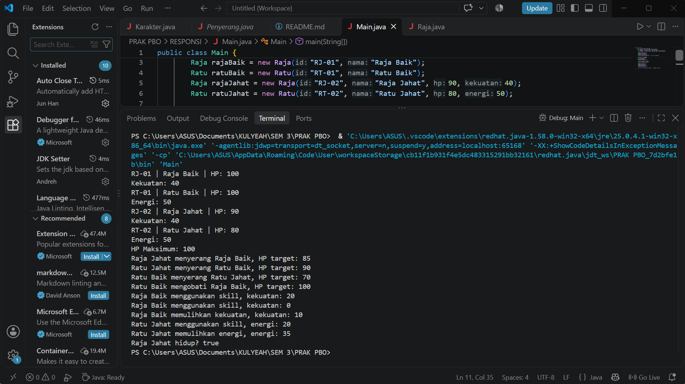

Nama : Salsabilla Rahma Diena
NIM : H1D025101
Tema : Game

DESKRIPSI GAME:
Menggambarkan pertarungan antar 2 kerajaan, yaitu kerajaan baik dan kerajaan jahat. Pertarungannya 2 vs 2 (Raja Baik, Ratu Baik) dan (Raja Jahat, Ratu Jahat). 
Superclass abstract : Karakter
Subclass nya ada : Prajurit dan Penyihir. 
kekuatan karakter dipisah lewat interface
Disini karakter Raja itu hanya bisa menyerang, tetapi untuk ratu dia bisa emmbantu menyerang lawan dan menyembuhkan raja (suaminya) yang terkena serangan.

Struktur File :
Karakter.java : Abstract class (superclass)
Prajurit.java : Subclass, implements Penyerang
Penyihir.java : Subclass, implements Penyerang, Penyembuh
Penyerang.java : Interface
Penyembuh.java : Interface
Main.java : Class pengujian

10 Persyaratan: 
State & Behavior    = Karakter : atribut, tampilkanInfo(), isHidup()
Immutability        = Karakter: public static final int HP_MAKSIMUM, private final String id 
Enkapsulasi & Overloading = Atribut "private" + getter/setter, " this",
Inheritance         = RAja dan Ratu extends Karakter;
Super Chaining      = super(id, nama, hp) di konstruktor Raja dan Ratu, super.tampilkanInfo()
Method Overriding   = @Override pada tampilkanInfo() di Raja dan Ratu
Abstract Class      = Karakter abstract, abstract method gunakanSkill()
Logika State if/else = gunakanSkill() di Raja (kekuatan) dan Ratu (energy)
Polimorfisme Interface = Main : Penyerang p1 = rajaJahat; dan Penyerang p2 = ratuJahat;
Multiple Interface  = Ratu implements Penyerang, Penyembuh

Cara Compile dan Run (Terminal):
install terlebih dahulu extension untuk java lalu klik "run" di bar atas lalu klik "startdebugging" atau F5

